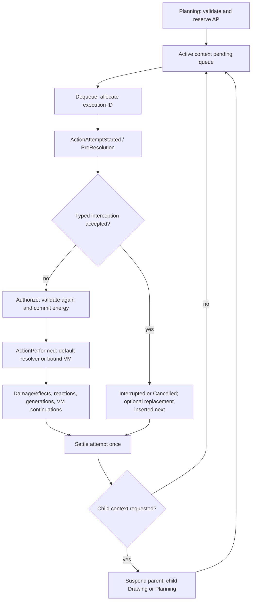

# Attacking stage, mutable action order, and execution contexts

## Scope and validation status

This change connects Planning, context-owned pending actions, action execution, reactive controls,
child windows, snapshots, and presentation. The supplied implementation brief defines the task;
the game design document informs the mechanics. Extra Actions and Extra Turns deliberately bypass
both normal TurnStart and normal TurnEnd.

Unity **6000.0.23f1** is required by `ProjectSettings/ProjectVersion.txt`. The cloud editor is
installed but cannot activate Unity Personal. **Unity import, compilation, source generation,
Edit Mode tests, Play Mode tests, player builds, and the visual smoke flow have not executed here.**
The PR must stay unmerged until local validation succeeds. No activation workaround is used.

The standalone .NET runner executes the production queue algorithms, snapshot-window identity
rules, and existing deterministic RNG tests without Unity. Roslyn syntax and generated component
catalog checks, CSharpier, Unity asset metadata/assembly checks, and Git whitespace checks provide
additional static validation. They do not establish that the Unity project compiles.

## Architecture before and after

Previously, contexts contained `PlannedAction` buffers while dispatch consumed an unrelated,
battle-level `ActionExecutionRequest` buffer. The context scaffolding did not participate in the
normal phase loop. NormalAttack emitted a placeholder event, and every drained action was
reported as successfully completed.

Now **the active context's `DynamicBuffer<PlannedAction>` is the only pending execution queue**.
Dispatch removes its first entry. There is no cursor to advance or reset after insertions. The old
`ActionExecutionRequest` type remains for serialized schema compatibility and generic snapshot
regression coverage; production creation does not add it and no production system consumes it.

- `ActionQueueService` validates manual submissions and reserves AP, or inserts validated
  automatic actions through the control processor.
- `ActionExecutionSystem` dispatches one entry only when prior event/VM work has settled.
- `BattleEventProcessingSystem` runs attempt interception, authorization, action programs, and
  all causal descendants before terminal completion. It applies typed scheduler requests at
  event phase boundaries.
- `BattlePhaseTransitionSystem` owns runtime transition policy. `AttackingStageExecutionManager`
  performs its synchronous commits and epoch/tag updates. Context creation and destruction occur
  outside live query iterations, after the causal chain settles.
- `ActionOrderPublication` exports stable identities and immutable presentation DTOs, while
  scheduler transition facts preserve intermediate order changes within an update.



## Identity, ownership, and provenance

IDs are nonzero and local to a battle. Interpret all IDs with the battle's `BattleID`.

| Identity | Lifetime |
| --- | --- |
| `QueueActionID` | Assigned when an action is inserted; unchanged by moves |
| `ActionExecutionID` | Assigned once when dequeued, separate from queue identity |
| `ContextID` | Assigned once when a normal/child context is constructed |
| `RequestID` | Monotonic scheduler-control identity, deduplicated when applied |
| `SelectionID` | Authorized pending-action interruption offer |
| Snapshot revision + context ID + phase epoch | Input/reversion generation fence |

A `PlannedAction` carries type/definition, submitter, actual source, target mode, optional primary
target, origin, causing execution, inherited source, and reserved manual AP. Reactive operations
are distinguished as passive, counterattack, follow-up, or interrupt replacement origins. Replacement
records the interrupted execution and source; the actual replacement actor remains the new source.
`PushInheritedStat` reads the inherited source's baseline Attack (0), Defense (1), or MaxHealth (2).

Every context has `OwnedBattle`; root counters, controls, pending child transitions/skips/selections,
context queues, AP, and target histories are ordinary snapshot-supported unmanaged ECS data.

## Planning, validation, and resources

`BattleInputGateway` stamps battle/context/phase/snapshot identity on commands. Manual queue,
remove, and move commands are accepted only from the active player's open Planning window.
Manual edits cannot remove or reorder an automatically inserted action. Opponent actors, invalid
or ambiguous runtime IDs, stale contexts/epochs/revisions, and completed Planning windows fail
without changing AP or the queue.

Manual character actions reserve **one AP** at submission. Removing a manual pending action from
Planning refunds its reservation once. Automatic actions reserve no AP. Mechanic-driven removals
(including an enemy selector) do not refund the original plan's AP. AP is not spent a second time
at execution. A manually planned source cannot reserve the same single-enemy target twice within
one context, and the context retains performed-target history. Child contexts have fresh histories.

Legality is checked again when the attempt authorizes: live source and target where applicable,
field membership, battle/player ownership, matching sides, action support, manual versus automatic
eligibility, binding range, and current energy. `ActionEligibility` exposes separate manual and
automatic masks. Absent that component, the supported binding determines availability. A target
that dies or leaves the field before dispatch causes a failed attempt without energy commitment.

Target modes are SingleEnemy, SingleAlly, Self, AllEnemies, and None. The latter two intentionally
carry no primary target. Bound action programs receive the selected target collection; team target
collections are sorted by stable runtime ID. Targetless actions may complete without a damage hit.

The default definition (ID 0) supports prototype Normal Attack (1× attack) and Supercharged Attack
(2× attack, 5 energy), using the existing damage pipeline. These are **generic fallback definitions,
not the individual character kits from the GDD**. An explicit `ActionProgramBinding` on an actor
maps `(CharacterActionType, DefinitionID)` to a validated content program, target mode, and energy
cost. Inputs cannot select an arbitrary VM program. Bindings can support other character-action
kinds. Full skill-card application, transformations, combined attacks, character balancing, and the
complete Karathos kit remain content/feature work outside this foundation; unsupported unbound
action kinds fail explicitly.

## Lifecycle and interruption

Lifecycle states distinguish Queued, AttemptStarted, Authorized, ConsequencesApplied, Completed,
Interrupted, Cancelled, and Failed.

1. Dispatch removes the pending entry, allocates an execution ID, opens a presentation packet,
   and emits `ActionAttemptStarted`.
2. PreResolution passives run through the ordinary trigger collector and VM. Typed interception
   requests apply before the attempt's resolver.
3. An interrupt/cancel is accepted only while `Outcome == AttemptStarted`. An accepted replacement
   is validated and inserted before changing the original outcome. An ineligible replacement
   leaves the original attempt able to proceed.
4. The resolver revalidates and authorizes the original only if it survived. Energy is spent here,
   after the interception window. `ActionPerformed` is a distinct gameplay hook; an attempt alone
   cannot trigger performed-action passives.
5. The normal damage/effect resolver pipeline and VM continuations run to causal settlement.
   The next action cannot dispatch while execution state, events, chained events, behaviour requests,
   or eligible child transitions remain.
6. A single terminal outcome is recorded. Interrupted/failed/cancelled attempts never emit ordinary
   successful completion. Their open presentation packets are discarded. `AttemptSettled` closes
   an interrupted/cancelled attempt without duplicating its earlier decision fact.

`ActionSchedulerIntegrationTests.RealKarathosPassiveInterruptsTomaBeforeEnergyAndInheritsSourceWithoutChildContext`
builds a test content blob with an actual PreResolution passive and `RequestActionControl`
instruction. It plans Mei → Toma Supercharged → Harun. Expected sequence is Mei complete → Toma
interrupted → Karathos Supercharged complete → Harun complete. Toma retains 5 energy; Karathos
spends his own 5. His bound VM program uses Toma's inherited Attack. No AP, child context, phase
entry, or counted turn is granted by replacement. This test is written but remains unexecuted here.

## Typed scheduler-control API

Game code can enqueue `ActionControlRequest` through `ActionControlProcessor.Enqueue`. VM
programs use `RequestActionControl`; direct writes to scheduler buffers are not the content API.
Normal VM requests carry their actual event frame, context, execution, trigger priority, owner
runtime ID, registration, and trigger index. Frame-zero requests apply in `ActionControlSystem`.

Requests at a boundary apply by priority descending, owner runtime ID ascending, registration
index, trigger index, then request ID. IDs are deduplicated across the current normal turn, with a
retired watermark preventing old requests from replaying later. Consecutive accepted insert-next
requests retain that sorted front order. Positional operations address the queue as it exists at
the time each sorted request applies.

| Operation | Effect |
| --- | --- |
| InsertNext / Append / InsertAt | Insert an automatic action before remaining work / at end / at index |
| InsertAfter | Resolve `RelativeQueueActionID`, then insert |
| RemovePending / MovePending | Resolve a stable pending ID; no executing-action cancellation |
| ReplacePending | Validate first, replace at the old position with a fresh queue ID |
| InterruptCurrent / CancelCurrent | Terminate a preauthorization attempt only |
| ReplaceCurrent | Interrupt and insert a replacement next in the same context |
| ExtraAction / ExtraTurn | Request a formal child window after the causal chain settles |
| SkipTurn / SkipStages | Request central phase policy; never directly write a phase |
| OfferInterruptSelection | Authorize an enemy player to select a pending action before Attacking |

VM instruction operands are A=control kind, B=action type (or stage mask), C=pending/relative ID
(or insertion/move position, depending on the operation). For ExtraAction/ExtraTurn, C instead
selects the actor: owner (0), event source (1), event target (2), or inherited source (3), allowing
future passives to grant a child window back to an interrupted ally. Otherwise the actor is the behaviour owner and the
target comes from the event/selected frame target. The C# API supplies the full typed fields for
more complex targeting. The authoring compiler preserves B/C through content baking, e.g.:

```text
RequestActionControl ReplaceCurrent SuperchargedAttack
End
```

`RuntimeIDEquals` conditions use `ReferenceID` as a **uint**, not a float. `ActionTypeEquals`
uses the same typed operand. Existing serialized enum values are preserved by appending new entries.

Preselected interruption requires a live offer matching player, context, and epoch, plus a still
pending stable queue ID. Committing Planning waits for outstanding selections. Removing the last
pending action expires remaining offers rather than deadlocking the stage. Already executing,
completed, removed, stale, and foreign selections are rejected.

## Normal and nested flow

| Context | Entry | Initial AP | Selectable actors | Exit |
| --- | --- | --- | --- | --- |
| Normal Turn | TurnStart → Drawing → Planning | Existing normal AP refresh | Active player's eligible field actors | Attacking → TurnEnd → next normal owner |
| Extra Action | Planning | Exactly 1 | Triggering actor only | Attacking → immediate parent Attacking |
| Extra Turn | Drawing → Planning | Exactly 4 | Child owner's eligible field actors | Attacking → immediate parent Attacking |

A child opens only after the current causal chain settles. The parent becomes Suspended with its
remaining AP and queue intact. Player ownership and active context switch together; the child
gets its own budget even if it belongs to the same player. Completion restores the immediate
parent's saved budget and player, clears stale completion tags, increments the phase epoch, and
resumes its remaining queue. Nesting is LIFO. Normal-only TurnStart/TurnEnd guards and the duration
processor prevent child windows from counting turns, emitting normal turn hooks, refreshing
turn-scoped restrictions, or ticking durations. Action-triggered passives still run normally.

Completed contexts remain available during their overarching normal turn for ancestry/reference
safety and are retired at its end. Pending child requests for a suspended parent wait for that
parent to become active again. A dead/ineligible actor at the handoff cannot open an unusable child.

Skip requests affect work that has not committed; they do not undo already resolved actions or
stage effects. `SkipTurn` applies to the targeted player's current remaining normal-turn stages or
next normal turn if the player is inactive. `SkipStages` for the active player is scoped to the
current context; a request for the inactive player applies to that player's next normal turn.
Stage systems consult the controller's shared skip policy before executing, including requests
received earlier in the same input update. Skipped Planning/Attacking drops that context's pending queue and selectors. Skipped TurnStart
performs no normal refresh or hooks; a skipped normal turn still consumes one counted normal-turn
slot. Skipped TurnEnd emits no normal end hook or duration tick. Child completion always resumes
the parent directly. Existing first-turn skip tags are consumed by this same controller.

## Determinism and safety limits

Limits are explicit: 256 pending actions per context, 256 queued controls per boundary, 2,048 applied
controls per normal turn, 512 dispatches across a normal turn and its children, and 16 child levels.
The existing event engine allows 10,000 frame/behaviour steps per update and the VM 256 instructions
per execution. Fixed target/stack collections are capacity checked. Invalid VM execution,
unsettled continuations, recursion limits, or exhausted scheduler identities halt the battle with
`ActionSchedulerState.Failure`; subsequent dispatch/phase/input work stops. No unrelated event
queue is silently cleared or falsely reported complete. Reload/restart the battle after a fatal
scheduler fault; automatic recovery from partially committed gameplay is not implemented.

The production pure queue algorithms run against an ECS buffer adapter and a standalone List
adapter in tests. Stable ordering, IDs, RNG, queues, energy, AP, conditions, and context graphs are
restored by the existing snapshot implementation. A snapshot window now includes context and
phase epoch, so identical stage names/player/turn numbers in nested windows cannot collide.
Child reversion restores that child's stage baseline, including the already committed parent
state, rather than returning to the parent's earlier Planning window. Entity references in nested
actions/contexts/control requests use the existing remapping codecs. The AOT catalog is regenerated.

## Presentation and development controls

Full initial and recovery snapshots include `ActionOrderSnapshot`; incremental publications share
the existing contiguous state-revision stream. `ActionOrderMirror` exists only in the presentation
world. It exposes active/suspended contexts, parent identity, AP, actor restriction, pending order,
executing state, target modes, origins, lineage, selection offers, and scheduler failure.

Ordered scheduler facts are consumed into a 64-transition debug history before animation packet
assembly. Several same-update mutations therefore remain observable even when the final queue
projection has already moved on. An action that fully settles within a simulation update may be
visible only in this ordered history; UI/timeline playback never holds up authoritative execution.
Reversion clears abandoned facts, packets, debug state/history, and export caches, then the normal
recovery snapshot reconciles the restored queue. The existing bridge/mirror design continues to
show one active battle per presentation world; concurrent simulation battles retain isolated IDs
and state, tested without sharing a presentation mirror.

Editor/development bootstrap installs `ActionOrderDebugView` automatically, beside the existing
snapshot smoke panel. It reads the presentation mirror, not simulation buffers:

1. Use the existing Drawing controls to deploy actors, then commit Drawing.
2. Select an actor and enemy target in the action-order panel. Plan Normal or Supercharged actions,
   reorder/remove manual entries, and commit Planning. Follow queue changes and terminal facts.
3. Revert Planning to inspect the restored pending order and AP.
4. Explicitly enable development controls to grant local debug authority. These still route typed,
   fenced, validated commands through the gateway. Insert/append automatic actions or arm a next
   attempt interruption/replacement/Extra Action/Extra Turn before committing a nonempty plan.
   Armed requests run at the next attempt's actual PreResolution boundary. Real passives use the
   ordinary VM path, as the synthetic integration scenario demonstrates.
5. Offer an enemy preselected interruption, then use the offered queue-row button to select the
   stable action ID. This local debug view can submit both players' choices; a production network
   client must bind player identity to its authenticated transport.
6. In a child window, observe the suspended parent queue/AP. Extra Action allows one actor/one AP;
   Extra Turn starts at Drawing with four AP. Finish it and observe the immediate parent's return.

The overlay is a development diagnostic, not a polished player UI or a full Karathos content demo.
No player credentials or license material are needed by it or the tests.

## Automated coverage and local verification

New Edit Mode suites cover queue operations and ties, real VM interruption/replacement/cancellation,
protected resources, performed hooks, multihit continuations, runtime-invalid actions, recursive
limits, simultaneous battles with overlapping card IDs, typed input/authoring, authorized selectors,
AP and manual/automatic eligibility, self/untargeted/AoE programs, normal/child phase flow, nested
opposing players, skip policy, snapshot replay/remapping, and full/incremental/recovery/reverted
presentation projections. Existing setup, context, and snapshot tests are extended. Play Mode adds
the development view lifecycle check alongside the existing cancellation/timeline tests. No test
assembly references or unsafe-code settings are relaxed.

On a locally activated Unity 6000.0.23f1 installation:

1. Check out this feature branch and open the repository's project in the matching editor.
2. Let Package Manager finish and the project import. Inspect Console for compiler and ECS
   source-generator errors before entering Play Mode.
3. Open **Window → General → Test Runner**, run **all EditMode tests**, then **all PlayMode tests**.
   Include the existing setup/snapshot suites, not only the new Scheduling namespace.
4. Enter the Bootstrap scene's Play Mode and exercise the development flow above. Review energy,
   queue order, child AP, turn counter, and reversion/recovery. A visual smoke pass remains required.

Equivalent commands from the repository root (replace the editor path):

```bash
UNITY='/path/to/6000.0.23f1/Editor/Unity'
RESULTS='/tmp/archeus-unity-results'
mkdir -p "$RESULTS"
"$UNITY" -batchmode -nographics -quit -projectPath "$PWD" -logFile "$RESULTS/import.log"
"$UNITY" -batchmode -nographics -projectPath "$PWD" -runTests -testPlatform EditMode \
  -testResults "$RESULTS/editmode.xml" -logFile "$RESULTS/editmode.log"
"$UNITY" -batchmode -nographics -projectPath "$PWD" -runTests -testPlatform PlayMode \
  -testResults "$RESULTS/playmode.xml" -logFile "$RESULTS/playmode.log"
```

Do not add `-quit` to the test invocations; let the test runner finish and exit. Inspect exit status,
XML test counts/failures, and logs. A successful editor import alone does not mean tests ran.
Return any compiler diagnostics, failing test names/XML, or runtime reproduction steps to the PR.
A standalone player/IL2CPP build and graphical playback remain additional unverified paths.

Without Unity, from this environment:

```bash
source /workspace/.state-archeus/env.sh
dotnet run --project Tools/StageSnapshotValidation/StageSnapshotValidation.csproj -- \
  --result=/tmp/archeus-pure-tests.xml
dotnet run --project Tools/StageSnapshotValidation/StageSnapshotValidation.csproj -- \
  --syntax-root "$PWD"
python3 Tools/generate_snapshot_catalog.py --check
python3 Tools/validate_snapshot_assets.py
git diff --check
```

Acceptance is implemented in source and covered by written tests; Unity-specific acceptance remains
pending local execution. The generic action/binding foundation, diagnostic UI, and explicit limits
are intentional scope boundaries, not claims that every mechanic or character in the GDD exists.
